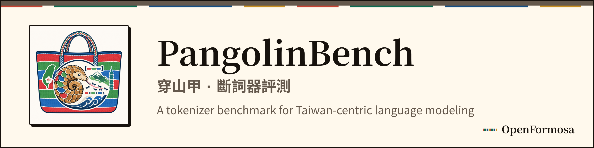

<p align="center"></p>

# PangolinBench

PangolinBench is a tokenizer benchmark for Taiwan-centric language modeling. It checks both whether a tokenizer restores text correctly and how efficiently it segments it.

<p align="center">
  <a href="LICENSE"></a>
  
  <a href="https://discord.gg/N4YnrjjcW7"></a>
</p>

<p align="center"><a href="README.md">繁體中文</a> · <b>English</b></p>

<p align="center">
  <a href="docs/PangolinBench.md">Docs</a> · <a href="https://openformosa.com/community/">Community</a>
</p>

## Why

A byte-level tokenizer can encode any UTF-8 text, yet still segment it badly. It may split Traditional Chinese, Bopomofo, Taigi romanization, Hakka romanization, or Taiwan-specific terms into too many pieces. Over-segmentation costs compute and makes learning harder.

PangolinBench therefore reports both roundtrip correctness and efficiency diagnostics: compression, lexicon fertility, over-segmentation, script coverage, rich transcription stability, and optional throughput. It also reports vocabulary size when available, because smaller vocabularies reduce embedding and output-head cost even when token counts are similar.

The name comes from the Formosan pangolin.

## Quick start

1. Install from source:

   ```bash
   git clone https://github.com/OpenFormosa/PangolinBench
   cd PangolinBench
   pip install -e .
   ```

2. Run a smoke test with the built-in byte roundtrip test adapter:

   ```bash
   python -m pangolinbench.cli \
     --byte-roundtrip-test-adapter \
     --config configs/pangolinbench.yaml \
     --output reports/pangolinbench_report.json
   ```

3. Open `reports/pangolinbench_report.json` to see roundtrip correctness and efficiency metrics per subset.

## Installation

| Item | Requirement |
| --- | --- |
| Python | 3.10 or later |
| Dependencies | The quality benchmark uses only the Python standard library |
| Optional | `pip install -e ".[throughput]"` (throughput benchmark, needs UbiTok); `pip install -e ".[transcription]"` (rich transcription) |

`import pangolinbench` and the quality benchmark never import `ubitok`. The dependency loads only when the throughput benchmark runs.

## Usage

### Evaluate your tokenizer

```bash
python -m pangolinbench.cli \
  --tokenizer path/to/tokenizer \
  --config configs/pangolinbench.yaml \
  --output reports/pangolinbench_report.json
```

### Call from the compatibility evaluator

```bash
python evaluate_tokenizer.py \
  --tokenizer path/to/tokenizer \
  --pangolinbench \
  --pangolinbench-config configs/pangolinbench.yaml \
  --output reports/evaluation_report.json
```

### Training-throughput benchmark

PangolinBench also ships a deterministic synthetic training-throughput benchmark. It measures how fast a tokenizer trainer ingests a synthetic mixed-script corpus. It trains a real tokenizer, so it needs UbiTok:

```bash
pip install ubitok
pangolinbench-throughput \
  --output-dir reports/throughput \
  --shard-count 8 \
  --lines-per-shard 1000 \
  --merge-count 128
```

### Use your own evaluation data

Built-in fixtures are synthetic, inspectable, deterministic, and license-clean. For real evaluation, plug in held-out corpora through a manifest. Do not commit private, licensed, or large corpora to this repository.

## Documentation

- [PangolinBench: motivation, subsets, and metrics](docs/PangolinBench.md)

## Limitations

- Built-in data is synthetic and suits smoke tests and behavior comparisons. Stronger claims need licensed held-out corpora.
- PangolinBench is not a general NLP benchmark. It evaluates tokenizer behavior only.
- The benchmark deliberately avoids dense timestamp token ranges.

## Contributing

OpenFormosa is a community project. Everyone can be a contributor.

- Questions and discussion: [Discord](https://discord.gg/N4YnrjjcW7) or the [community page](https://openformosa.com/community/)
- Bugs and new subsets: [Issues](https://github.com/OpenFormosa/PangolinBench/issues)
- Pull requests: read [CONTRIBUTING.md](https://github.com/OpenFormosa/openformosa.com/blob/main/CONTRIBUTING.md) first
- General contact: <hello@openformosa.com>
- Security: <security@openformosa.com> (please do not open a public issue)
- Code of conduct: [CODE_OF_CONDUCT.md](https://github.com/OpenFormosa/openformosa.com/blob/main/CODE_OF_CONDUCT.md); report to <conduct@openformosa.com>

## License

Code and documentation in this repository are released under the [Apache License 2.0](LICENSE), © 2026 OpenFormosa contributors.

Evaluation corpora referenced through manifests are not covered and keep their own licenses.

## Acknowledgements

Compute and research support come from Taipei-1, NTU Speech Lab, and NTU SPML Lab. Thanks to everyone who opened an issue, sent a pull request, or joined the discussion.

## Citation

```bibtex
@misc{openformosapangolinbench2026,
  title  = {PangolinBench: A Tokenizer Benchmark for Taiwan-Centric Language Modeling},
  author = {{OpenFormosa contributors}},
  year   = {2026},
  url    = {https://github.com/OpenFormosa/PangolinBench}
}
```
