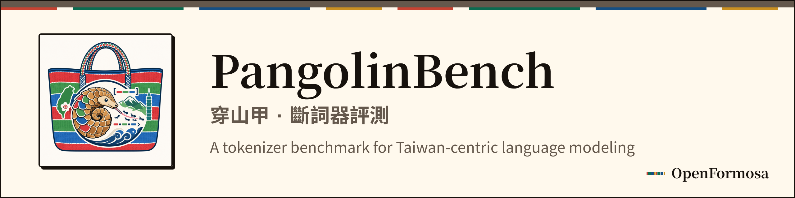

<p align="center"></p>

# PangolinBench

PangolinBench 是給台灣語言情境用的斷詞器評測。它同時檢查斷詞器能不能正確還原文字，以及切分是否有效率。

<p align="center">
  <a href="LICENSE"></a>
  
  <a href="https://discord.gg/N4YnrjjcW7"></a>
</p>

<p align="center"><b>繁體中文</b> · <a href="README.en.md">English</a></p>

<p align="center">
  <a href="docs/PangolinBench.md">文件</a> · <a href="https://openformosa.com/community/">社群</a>
</p>

## 為什麼做這個

一個 byte-level 斷詞器可以編碼任何 UTF-8 文字，但不一定切得好。它可能把繁體中文、注音、台羅、客語拼音或台灣專有名詞切得太碎。切得太碎，模型就要多花運算，也比較難學。

PangolinBench 因此同時回報兩件事：還原是否正確，以及效率診斷。檢查項目包括壓縮率、詞彙 fertility、過度切分、文字系統覆蓋、rich transcription 穩定性，以及選用的吞吐量。有提供時，它也回報詞彙表大小，因為較小的詞彙表可以降低 embedding 與輸出層的成本。

名稱取自台灣穿山甲。

## 快速開始

1. 從原始碼安裝：

   ```bash
   git clone https://github.com/OpenFormosa/PangolinBench
   cd PangolinBench
   pip install -e .
   ```

2. 用內建的 byte roundtrip 測試轉接器跑一次煙霧測試：

   ```bash
   python -m pangolinbench.cli \
     --byte-roundtrip-test-adapter \
     --config configs/pangolinbench.yaml \
     --output reports/pangolinbench_report.json
   ```

3. 打開 `reports/pangolinbench_report.json`，會看到各子集的還原正確率與效率指標。

## 安裝

| 項目 | 需求 |
| --- | --- |
| Python | 3.10 以上 |
| 相依套件 | 品質評測只用 Python 標準函式庫 |
| 選用 | `pip install -e ".[throughput]"`（吞吐量評測，需要 UbiTok）；`pip install -e ".[transcription]"`（rich transcription） |

`import pangolinbench` 與品質評測不會載入 `ubitok`。只有真正執行吞吐量評測時才會載入。

## 使用範例

### 評測你的斷詞器

```bash
python -m pangolinbench.cli \
  --tokenizer path/to/tokenizer \
  --config configs/pangolinbench.yaml \
  --output reports/pangolinbench_report.json
```

### 從相容的評測腳本呼叫

既有的評測流程可以加上 PangolinBench 參數：

```bash
python evaluate_tokenizer.py \
  --tokenizer path/to/tokenizer \
  --pangolinbench \
  --pangolinbench-config configs/pangolinbench.yaml \
  --output reports/evaluation_report.json
```

### 訓練吞吐量評測

PangolinBench 也提供固定、合成的訓練吞吐量評測。它量測斷詞器訓練器讀取多文字系統合成語料的速度。這項評測會實際訓練斷詞器，所以需要 UbiTok：

```bash
pip install ubitok
pangolinbench-throughput \
  --output-dir reports/throughput \
  --shard-count 8 \
  --lines-per-shard 1000 \
  --merge-count 128
```

### 使用自己的評測資料

內建的測試資料都是合成的，可以檢視、結果固定，也沒有授權問題。正式評測請透過 manifest 接上保留的評測語料，不要把私人、有授權限制或大型的語料提交到這個 repository。

## 文件

- [PangolinBench 說明：動機、子集與指標](docs/PangolinBench.md)

## 限制

- 內建資料是合成的，只適合煙霧測試與比較行為。要對斷詞器下更強的結論，需要接上有授權的保留語料。
- PangolinBench 不是通用 NLP 評測，它只評估斷詞器行為。
- 評測刻意避開密集的時間戳記 token 範圍。

## 參與貢獻

OpenFormosa 是社群專案，每個人都可以是貢獻者。

- 討論與提問：[Discord](https://discord.gg/N4YnrjjcW7) 或 [社群頁](https://openformosa.com/community/)
- 回報問題或提議新子集：[Issues](https://github.com/OpenFormosa/PangolinBench/issues)
- 送出修改：請先讀 [CONTRIBUTING.md](https://github.com/OpenFormosa/openformosa.com/blob/main/CONTRIBUTING.md)
- 一般聯絡：<hello@openformosa.com>
- 安全問題：<security@openformosa.com>（請不要公開發 issue）
- 行為準則：[CODE_OF_CONDUCT.md](https://github.com/OpenFormosa/openformosa.com/blob/main/CODE_OF_CONDUCT.md)，回報請寄 <conduct@openformosa.com>

## 授權

本 repository 的程式碼與文件以 [Apache License 2.0](LICENSE) 釋出，© 2026 OpenFormosa contributors。

透過 manifest 引用的評測語料不在此授權範圍內，依其原始條款使用。

## 致謝

本專案的運算資源與研究支持來自 Taipei-1、臺大語音實驗室（NTU Speech Lab）與 NTU SPML Lab。感謝每一位提出問題、送出 PR 與參與討論的貢獻者。

## 引用

```bibtex
@misc{openformosapangolinbench2026,
  title  = {PangolinBench: A Tokenizer Benchmark for Taiwan-Centric Language Modeling},
  author = {{OpenFormosa contributors}},
  year   = {2026},
  url    = {https://github.com/OpenFormosa/PangolinBench}
}
```
